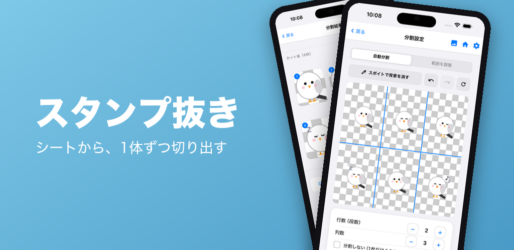
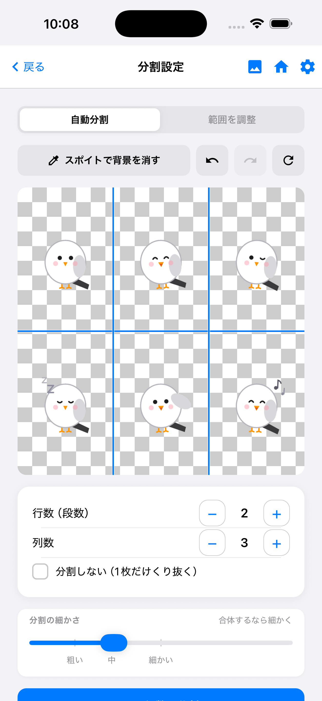
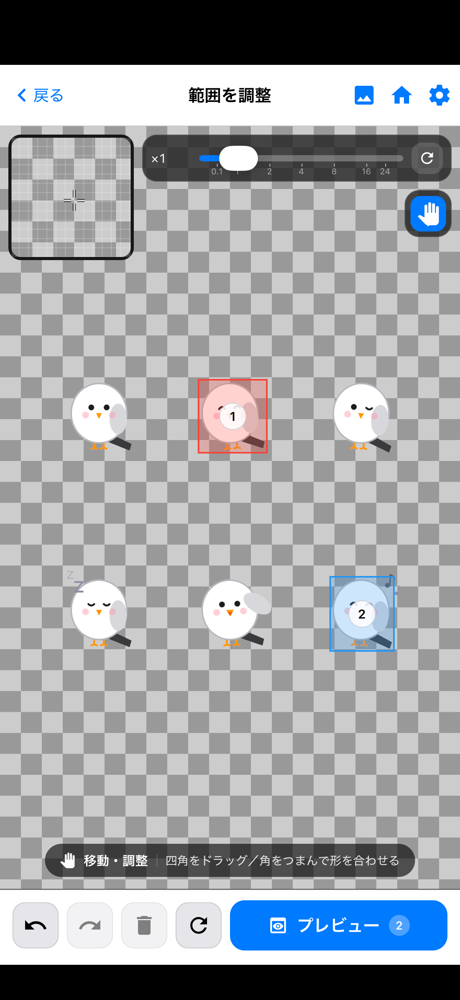
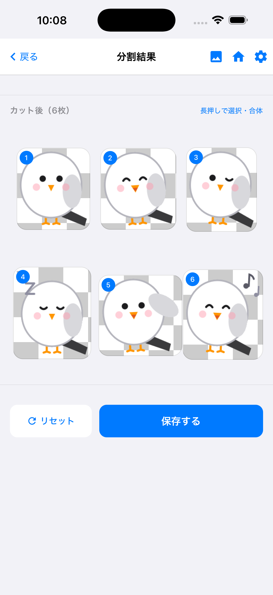

# スタンプ抜き

AIイラストシートからキャラクターを1体ずつ切り出し、背景を除去して透過PNGを書き出すアプリです。iOS / Android 対応。LINEスタンプの申請用画像を作ることを想定しています。

複数体が並んだ1枚を読み込むと、背景を透過し、1体ずつの範囲を推定して切り出します。自動処理だけで100%揃うことは少ないため、**手動で直すための編集**に最も力を入れています。

選択した画像や生成した画像を外部サーバーへ送信しません。処理はすべて端末内で完結します。

<a href="https://apps.apple.com/us/app/id6798574833"></a> &nbsp; [**App Store で見る**](https://apps.apple.com/us/app/id6798574833) ／ [**Google Play で見る**](https://play.google.com/store/apps/details?id=com.seraapps.stampnuki)

---

## 分割設定 — シートを読み込んで分ける



#### 自動分割
行数・列数を指定すると、すき間を見て分割線を置きます。線がキャラに乗っていたら、指でドラッグしてずらします。細かさのスライダーは、小さいすき間でも線を入れるかどうかを決めます。

#### スポイトで背景を消す
分割線の上から、残った背景色をタップして追加で透過できます。1枚だけくり抜く（分割しない）こともできます。

#### 背景除去の方式
既定は色ベースです。複雑な背景や人物には、被写体検出（iOS は Vision、Android は ML Kit）に切り替えられます。方式を変えるとその作業の囲みやスポイトは消えて、同じ画像で最初からになります。

<br clear="all" />

---

## 範囲を調整 — 自動でうまくいかないとき



#### 四角で囲む
保存したいキャラをペンで囲みます。囲んでいない絵は、確認画面にも保存にも出ません。白い点を動かして形を合わせ、辺のタップで頂点を足し、長押しで消せます。

#### 候補から選ぶ
未囲みの塊を色枠で示し、選んだ分だけまとめて四角を置けます。バラバラ・重なりなど、同じ線では切れないシート向けです。

#### 直す道具
スポイト、なぞって透過する消しゴム、消えすぎを戻す復元ブラシ、範囲を指定して透過をやり直す再透過。指で隠れる位置はルーペで拡大できます。

<br clear="all" />

---

## 分割結果 — 確認して書き出す



#### 一覧
切り出した透過PNGを並べて確認します。下地を市松・白・黒に切り替えて、消し残しや消えすぎを見ます。

#### 合体と1枚編集
隣り合って割れてしまった枚は、長押しして合体できます。1枚をタップすると、その枚だけ「範囲を調整」に入れます。

#### 保存
写真アルバムへ透過PNGとして保存します。読み込みは PNG・JPEG・HEIC。保存は透過PNGだけです。

<br clear="all" />

---

## そのほか

- **日本語 / 英語** 対応（端末の設定に追従、アプリ内で固定も可能）
- 使い方はアプリ内に収録。各画面の「？」から、その画面の説明だけが開けます
- 初回起動時に流れを案内します。設定からいつでも見直せます
- 選択した画像・生成した透過PNG・利用統計は**端末内**にのみ保存され、外部へ送信していません
- 広告（AdMob）とその同意管理（UMP）のための通信はあります（詳細は[プライバシーポリシー](https://hisakawaserai-svg.github.io/bg-remover/privacy.html)）
- [サポート](https://hisakawaserai-svg.github.io/bg-remover/support.html)

## 技術スタック

- **React Native 0.86** / React 19 / TypeScript 5.9
- **@shopify/react-native-skia** — 編集キャンバスの描画
- **react-native-reanimated** / **react-native-worklets** — アニメーション
- 画像処理はプロジェクト内に実装（色ベースの背景除去・分割）。被写体検出は端末の Vision / ML Kit を使用。画像そのものを外部APIへ送る処理はありません
- **react-native-fs** / **AsyncStorage** — 作業データと設定
- **react-native-google-mobile-ads** — AdMob + UMP
- **Jest** — 画像処理の純粋関数に対するユニットテスト

規模は約 32,000 行（`src/` 配下、TypeScript）。

## 開発

```bash
npm install
npm start
npm run ios       # または npm run android
npm test
npm run lint
```

## リポジトリ構成

```
.
├── App.tsx / index.js
├── src/
│   ├── components/   # 各画面・編集UI
│   ├── imaging/      # 背景除去・分割・書き出し（テスト付き）
│   ├── i18n/         # 日本語・英語の辞書
│   ├── settings/     # 設定の永続化
│   ├── ads/          # AdMob / 同意
│   └── licenses/     # OSS ライセンス全文
├── ios/ / android/   # ネイティブプロジェクト
├── screenshots/      # README・ストア用画像
├── docs/             # プライバシーポリシー・サポートページ
└── CHANGELOG/        # 版ごとのリリースノート
```

## なぜソースを公開しているか

**透明性のためです。**

このアプリは、選んだイラストを端末内で処理します。画像をどこにも送っていない ―― と説明することはできますが、閉じたアプリでは利用者にそれを確かめる手立てがありません。

だからソースを公開しています。何をしているアプリなのか、入力した画像をどう扱っているのかを、誰でも自分の目で検証できる状態にしておくためです。

## 利用について

**公開していますが、自由に使ってよいという意味ではありません。**

読むこと・中身を確認することは歓迎します。一方で、コードの複製や再配布、別の製品への転用、アプリ名やアイコン・イラストの流用は許諾していません。

隠していないことを示すために公開しているのであって、配布のために置いているわけではありません。

使用しているオープンソースライブラリのライセンスは、アプリ内の「設定 → このアプリ → オープンソースライセンス」から確認できます。
